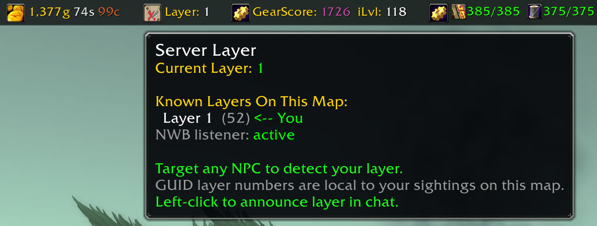

# TitanLayer

TitanLayer is a lightweight Titan Panel plugin that displays the layer you have observed on a layered World of Warcraft realm. On **World of Warcraft: Forever** (`Interface 16001`), it can no longer detect layers since a server update on 20 November 2026; see below.

*The TitanLayer button and its tooltip, on TBC Anniversary.*

## Install

Download the latest release, then extract the `TitanLayer` folder to your client's `Interface/AddOns` directory. Install and enable Titan Panel as well; it is a required dependency.

## How detection works

TitanLayer reads the zone identifier in a creature's GUID when you target or mouse over an NPC. It ranks the identifiers it has seen on your **current realm and map**, in ascending order. Until it sees a usable NPC, the bar shows `?`.

This number is local to your sightings, not an official server-wide layer number. Seeing another identifier can renumber a layer you already know. Nameplates can confirm an identifier already known on the current map, but they do not discover new ones: nearby nameplates can belong to a different map across a zone border. Detection is skipped on taxis and inside instances.

**On WoW Forever, layer detection is off since version 1.3.0.** A server update on 20 November 2026 stopped NPC GUIDs from revealing the layer, and Blizzard announced the same day that it would disable layering addons. Seven NPCs read together in one zone, two of them side by side, gave seven different values in both GUID fields that ever held one: the server field and the zone field (measured on build 1.60.1.71037). TitanLayer 1.2.0 read the GUID's server field there; nothing replaces it. On Forever the bar shows `off`, the tooltip explains why, and TitanLayer reads no NPCs, saves nothing and doesn't listen to NovaWorldBuffs. Its saved sightings are cleared.

Totems, guardians and other player-controlled NPCs never count, on any client: they carry the layer they were summoned on.

## Features

- Show the current observed layer on the Titan Panel bar.
- Detect layers from target and mouseover NPCs; optionally scan nameplates to confirm known layers.
- Left-click to announce the layer in say, party, or guild chat, or print it only to your chat window. Local print is the default; choose a channel from the right-click menu.
- Show the current layer and known identifiers for the current map in the tooltip. When NovaWorldBuffs guild messages are available, the tooltip shows their reported layer distribution instead.
- Save sightings by realm and map. They expire two hours after their last sighting.
- Optionally prefer NovaWorldBuffs' current-layer value when that addon is installed. TitanLayer can also listen to NovaWorldBuffs guild messages without requiring NovaWorldBuffs on your own client; the highest reported number is only the highest observed, not a guaranteed total.

## Commands and options

| Command | Action |
| --- | --- |
| `/titanlayer` or `/tlayer` | Print the current reading and listener status. |
| `/titanlayer reset` or `/tlayer reset` | Clear saved sightings for the current realm and the in-memory NovaWorldBuffs reports. |

Right-click the TitanLayer button to choose the announcement channel, show the GUID zone identifier, prefer NovaWorldBuffs data, toggle nameplate scanning, or reset layer data.

**On WoW Forever** none of this applies: `/titanlayer`, `/titanlayer reset` and a left-click only print why detection is off, and the right-click menu holds just Titan Panel's own display options.

## Compatibility notes

The TOC also lists interface numbers for several other WoW clients. A realm must expose readable creature GUIDs and use layers for detection to be useful. Wrath Classic is **not** listed in the current TOC, so compatibility with it is not claimed here.

The NovaWorldBuffs listener is bounded: a guild message over 4 KB is ignored before it is decoded (a layer report is far smaller; NovaWorldBuffs' large data broadcasts carry nothing TitanLayer reads), a half-received message is forgotten after a minute, and only a whole number from 0 to 50 counts as a layer. `docs/AUDIT.md` has the audit; `tests/nwb.lua` runs it offline.

Version 1.1.0 replaces the older flat saved-sighting list with realm-and-map storage. Older sightings are cleared on upgrade because they cannot be assigned safely to a map. On WoW Forever, version 1.2.0 cleared saved sightings once more, because those were zone identifiers, not layers, and version 1.3.0 clears them for good, since no layer can be read there any more; other clients keep theirs.
